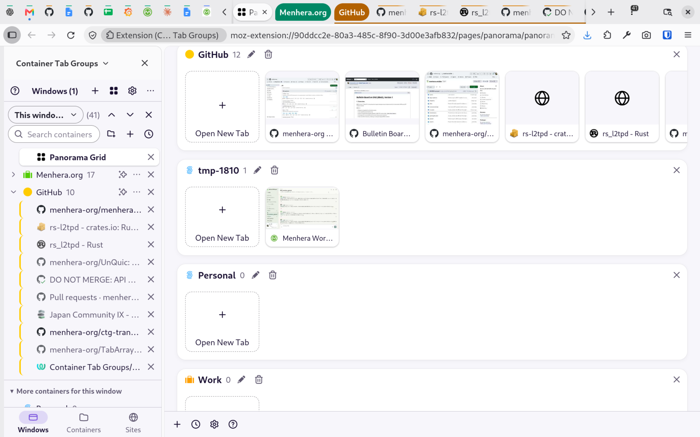
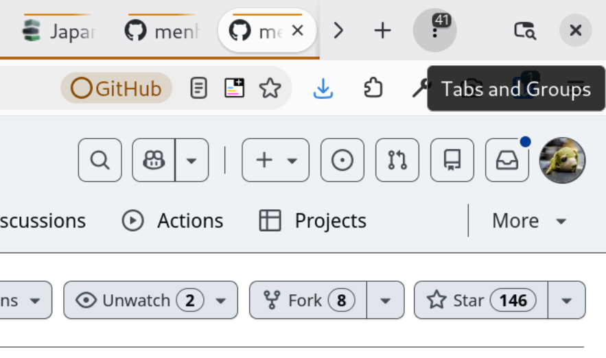

# Container Tab Groups

[](https://dl.circleci.com/status-badge/redirect/gh/menhera-org/TabArray/tree/main)
[](https://addons.mozilla.org/firefox/addon/container-tab-groups/)
[](https://addons.mozilla.org/firefox/addon/container-tab-groups/)
[](https://www.typescriptlang.org/)
[](https://www.gnu.org/licenses/gpl-3.0.en.html)
[](https://qlty.sh/gh/menhera-org/projects/TabArray)
[](https://hosted.weblate.org/engage/container-tab-groups/)

Chrome-like tab groups using private and isolated containers: The ultimate tab manager and groups for Firefox.

[](https://addons.mozilla.org/firefox/addon/container-tab-groups/)  
[Download for Firefox](https://addons.mozilla.org/firefox/addon/container-tab-groups/)

[Latest unsigned builds from CI](https://downloads.menhera.org/ctg/) (To download builds from this site, please right-click and save to prevent errors when Firefox tries to "install" downloads.)

[About Container Tab Groups](https://www.menhera.org/container-tab-groups/)



[](https://app.circleci.com/insights/github/menhera-org/TabArray/workflows/build/overview?branch=main&reporting-window=last-30-days&insights-snapshot=true)

## Features

_Tab Group = Container_

_Better than Chrome!_

- Requires no setup before/after installation.
- Isolated cookies/logins for each of tab groups because they are containers.
- Per-window container management.
- Temporary containers and auto-cookie-discarding containers.
- Automatically sorts tabs based on containers.
- Manage tabs based on the domains of websites.
- Provides you with a menu where you can do the following actions:
    - List all the tabs for a window.
    - Show/hide tabs of a container.
    - Create and delete containers as you like.
    - Switch windows.
- Enables First-Party Isolate (privacy.firstparty.isolate; FPI) by default. (Configurable.) **This means that cookies for different sites, even for a same container, are separated by registrable domain.** It also enables natural and flicker-free openings of new windows by websites, unlike simulated FPI by manipulating containers. This is the way Tor Browser is using.
- Allows the user to enable fingerprinting resistance (privacy.resistFingerprinting).
- Per-container overrides of the language and the user agent settings.

### Groups

- You can group containers.
- Each container appears as a Firefox tab group in the tab bar, with the container's name and color. This can be turned off in the settings.

## Usage

The button to open the main controls is by default added at the tab bar at the top, as shown below. The button has three dots.



1. Before starting a task, create a new container for it!
2. Open tabs related to the task in that container.
3. When finished, delete the container to remove all the clutters.

## Intention

This extension is designed to be the best tab group extension/addon for Firefox.

This extension is intended to replace the following features/extensions:

- Conex, an extension which is not updated recently.
- Google Chrome's tab groups.

## Known issues

- View source (view-source: URLs) on No Container does not work. This is the limitation of WebExtensions API.
- HTTP requests in "No Container" (default container) are a little slower than ones in containers.

## Compatiblity

### Compatible

- Firefox Multi-Account Containers
- Facebook Container
- Temporary Containers
- Tab Session Manager
- Most extensions that changes the New Tab page.

Probably more compatible extensions...

### Incompatible

- Tree Style Tab
- Simple Tab Groups (?)
- Many other tab management extensions? (#32)

### Compatibility To Do's

- Improve the compatibility with top 10 popular tab management extensions, for example
- Export the APIs to work nicely with Tree Style Tab
- Make this extension compatible with Simple Tab Groups, or make this extension feature-rich
enough to unnecessitate Simple Tab Groups.

## What's next

- **NEW**: Firefox's native tab groups will be integrated.
- Keyboard shortcuts will be implemented. → The first implementation is available.

## Available languages

- English
- 日本語
- Français
- Esperanto
- Español
- Русский
- Deutsch
- Čeština
- Galego
- Interlingua
- 中文 (简体)
- Português (do Brasil)

This project uses Hosted Weblate for translation. You can contribute translations at Hosted Weblate.

[](https://hosted.weblate.org/engage/container-tab-groups/)

[Translate to your language](https://hosted.weblate.org/engage/container-tab-groups/)

**When translation is "closed for maintenance", please notify @metastable-void.**

### Translation Managers

- metastable-void (ja, eo, ia)
- 佐々木Alex🐇 (Sasaki Alex🐇) (fr, es-ES, ru)

## About the project

- _TabArray_ is the code name, and _Container Tab Groups_ is the user-facing name.
- The official extension ID is `tab-array@menhera.org`. (Not an email address.)
- To contact the developers, use [Google Groups](https://groups.google.com/a/menhera.com/g/ctg-l) or [GitHub discussions](https://github.com/menhera-org/TabArray/discussions).

### Version scheme

We use the following version scheme:

```
major.minor.maintenance.build
```

We make releases when first three version numbers change. The build version (fourth part) is purely informational.

For example, we just call 11.8.1.200 release 11.8.1.

#### Build version

Versions ending with .1xx are development versions, and versions ending with .2xx are release versions.

The two digits after 1 or 2 indicate patch level.

## Building the extension

1. Clone this repository.
2. Install the latest Node.JS/NPM using [NVM](https://github.com/nvm-sh/nvm).
3. In this directory, run `npm ci` to install the dependencies listed in `package-lock.json`.
4. Run `npm run build` to build the extension. Built extension's path is printed on console (usually under the `builds/` directory).

`npm run build-for-amo` is the same build. AMO's automated source rebuild uses this script name.

### Build environment (for AMO reviewers)

- **Operating system:** Linux, x86-64 or ARM64. `package-lock.json` includes the native packages of the build tools (rolldown, Lightning CSS, oxlint, oxfmt, TypeScript) for both.
- **Node.js:** any version that `package.json` accepts (`^20.19.0 || >=22.12.0`), with the npm that comes with it. Node 24.14.0 with npm 11.9.0, AMO's default, and Node 26.13.0 with npm 11.20.0 produce byte-identical output on Linux x86-64.
- **Commands:** in the extracted source, run `npm ci`, then `npm run build-for-amo`. The build itself needs no network access and no Git.
- **Output:** the files of the extension in `dist/`, and the package in `builds/<version>/ctg-<version>-<commit time>-<commit>.xpi`.
- **npm warnings:** npm before 11.20 warns about the unknown `min-release-age` settings in `.npmrc`. They only delay new dependency releases when someone runs `npm install`, and do not affect `npm ci` or the build.
- The path of the source directory may contain spaces.


### Reproducible builds

This project uses reproducible builds. This means built extensions from the same source are always the same.

To use this feature, make sure that:

- You build an extension either directly from a clean Git checkout (with Git installed), or from a source tarball made by `npm run package-source`.
- You install dependencies with `npm ci`, so they match `package-lock.json`.

`npm run package-source` writes `builds/<version>/ctg-<version>-<commit time>-<commit>-source.tar.gz` from `HEAD` and refuses to run with uncommitted changes. It works like `cargo package`: the tarball contains `.menhera_vcs_info.json`, which records the commit hash and the commit's date. Builds from the tarball read them from that file instead of Git, so they produce the same extension as a build from that commit. This is the source package to upload to AMO.

Since the hashes are the same, an extension you build from the official source passes **Check for Official Build** in the help view, which then shows a green checkmark next to the version. The button downloads this version's signature from `downloads.menhera.org`; nothing is downloaded until you click it.

When checking the integrity of package, certain files are ignored:

- Cryptographic signature files from Mozilla are ignored. (So that versions from addons.mozilla.org should show that they are "official.")
- The `manifest.json` file may be transformed by Mozilla, so only equivalence is checked.

## FAQs

### Will this be available for Chrome?

This extension depends on many technologies not available in Chrome (only in Firefox),
where the most important is Firefox's isolated containers feature.
So it would not be possible.

### When will (feature) be released?

See the [issues](https://github.com/menhera-org/TabArray/issues).
Something missing you need? Please file a new feature request there.

## License

Copyright &copy; 2026 Menhera.org contributors.

Licensed under GNU GPL version 3 **or later**.

### Used assets

- Icons and design tokens from Firefox (MPL-2.0): see `src/css/vendor/README.md`

`static/NOTICE`, which ships in the extension, lists these files and their license.
